# Awesome AI Code Search 🔍 ⚡

  

> **Curated directory of AI Code Search engines, Semantic Code Search platforms, Codebase RAG (Retrieval-Augmented Generation) systems, and Code Intelligence developer tools.**

A comprehensive, battle-tested guide to modern developer tools for indexing, navigating, understanding, and retrieving code across massive multi-repository enterprise codebases and open-source ecosystems.

---

## 📑 Table of Contents

- [🧠 Overview & Architecture Paradigms](#-overview--architecture-paradigms)
- [📈 Sector Overview & Market Dynamics](#-sector-overview--market-dynamics)
- [🏢 SaaS / Hosted AI Code Search Platforms](#-saas--hosted-ai-code-search-platforms)
- [🐙 Open-Source GitHub Projects](#-open-source-github-projects)
- [⚖️ Evaluation Matrix: How to Choose](#️-evaluation-matrix-how-to-choose)
- [🤝 How to Contribute](#-how-to-contribute)
- [📜 Disclaimer & License](#-disclaimer--license)

---

## 🧠 Overview & Architecture Paradigms

Traditional code search relied purely on regex patterns and string matching (e.g., `grep`). Modern **AI Code Search** operates across four interconnected technological pillars:

1. **⚡ Trigram & Lexical Indexing**: Ultra-fast literal and regular-expression searches across gigabytes of source code in milliseconds (e.g., *Zoekt*, *ripgrep*).
2. **🌳 Structural & AST Parsing**: Abstract Syntax Tree queries that understand programming language grammar, symbol hierarchies, definitions, and references (e.g., *Tree-sitter*, *ast-grep*, *Semgrep*).
3. **🧬 Dense Vector Embeddings & Codebase RAG**: Deep learning models converting code blocks and natural language into high-dimensional vector spaces for semantic similarity retrieval (e.g., *bloop*, *Khoj*, *Tabby*).
4. **🤖 Agentic Context Engines**: Multi-step autonomous retrieval agents that generate dynamic repo maps, gather cross-file dependencies, and synthesize answers using frontier LLMs (e.g., *Cursor*, *Windsurf*, *OpenHands*, *Cline*, *Aider*).

---

## 📈 Sector Overview & Market Dynamics

The global AI developer tools and intelligent code search market is currently estimated at **$7.5B to $9.5B** in 2025–2026, with long-term forecasts projecting over **$30B+ by 2030** (growing at an ~24% CAGR) driven by developer adoption of codebase RAG and agentic workflows.

The sector is **moderately fragmented but rapidly concentrating**: while hyperscaler incumbents (Microsoft/GitHub, Amazon, Google) command vast distribution through enterprise agreements and cloud lock-in, innovative high-velocity startups (Cursor/Anysphere, Codeium/Windsurf, Augment Code, Sourcegraph) have captured substantial developer mindshare with specialized low-latency indexing, multi-repo retrieval, and agentic IDE ergonomics—preventing an immediate winner-take-all consolidation.

---

## 🏢 SaaS / Hosted AI Code Search Platforms

Commercial solutions providing turnkey multi-repository indexing, IDE extensions, enterprise compliance, and managed context engines. Sorted descending by company size (valuation / market capitalization):

| Product | Company Size (Valuation / Market Cap) | Starting Price | Free Tier / Trial Limit | Key AI Search & Code Intelligence Capabilities |
| :--- | :--- | :--- | :--- | :--- |
| **[GitHub Copilot](https://github.com/features/copilot)** (Microsoft) | ~$3.1T Market Cap ($1B+ GitHub ARR) | $10/month (or $100/year for Individual) | **Free Forever Plan**: 2,000 code completions/month & 50 chat messages/month (or 30-day free trial on Copilot Pro) | In-editor & PR semantic search, Copilot Chat, repository-wide indexing, multi-model selection (Claude 3.5 Sonnet, GPT-4o) |
| **[Amazon Q Developer](https://aws.amazon.com/q/developer/)** (Amazon AWS) | ~$2.1T Market Cap ($575B+ annual revenue) | $19/user/month (Pro tier) | **Free Forever Plan**: 50 agentic requests/month, 1,000 lines code transformation/month, unlimited inline suggestions | Enterprise repository and AWS architecture search, context-aware code generation, vulnerability scans, Java upgrades |
| **[JetBrains AI](https://www.jetbrains.com/ai/)** (JetBrains) | ~$7.0B Valuation (~$450M annual revenue) | $10/month (or $100/year for Individual AI Pro; $20/user/month for orgs) | **Free Forever Plan**: Unlimited local model completions + 3 cloud AI credits per 30 days (or 30-day AI Pro free trial) | IDE-native AST semantic search, cross-file project indexing, multi-backend LLM routing, inline chat assistance |
| **[Sourcegraph](https://sourcegraph.com/)** (Sourcegraph Inc.) | $2.625B Valuation (Series D) | $59/user/month (Cody Enterprise; minimum annual agreement) | **Free Trial**: 14-day Enterprise trial with full platform access upon request (standalone consumer free tier sunsetted) | Multi-repository scale semantic search, Zoekt-indexed trigram search, SCIP code intelligence graph, Cody AI assistant |
| **[Cursor](https://cursor.com/)** (Anysphere) | $2.5B Valuation (backed by Benchmark & OpenAI) | $20/month (Pro tier) | **Free Forever Plan** (Hobby): 2,000 completions/month & 50 slow premium requests/month (includes 14-day Pro trial on signup) | AI-native VS Code fork with repository embedding indexing, `@codebase` semantic context retrieval, Composer multi-file agent |
| **[Codeium](https://codeium.com/)** (Exafunction) | $1.25B Valuation (Series C) | $12/user/month (Teams billed annually; $15/user/month billed monthly) | **Free Forever Plan** (Individual): Unlimited autocomplete suggestions, unlimited chat, in-IDE codebase search & indexing | Fast in-IDE vector search & indexing across 40+ IDEs, multi-line completions, enterprise context retrieval |
| **[Windsurf](https://codeium.com/windsurf)** (Codeium / Exafunction) | $1.25B Valuation (Series C) | $15/month (Pro tier) | **Free Forever Plan**: Unlimited fast Tab completions, inline edits, 25 prompt/flow credits/month, 1 app deploy/day | Cascade agentic AI flow, deep real-time codebase awareness, multi-file navigation, autonomous command execution |
| **[Augment Code](https://www.augmentcode.com/)** (Augment Code Inc.) | $977M Valuation ($227M raised) | $20/month (Standard team base plan covering up to 50 seats with $20 usage credit included) | **Free Trial**: 30,000 trial credits upon signup with payment card (no permanent free tier) | Proprietary Context Engine indexing massive enterprise codebases, real-time semantic dependency search, high-speed completions |
| **[Tabnine Enterprise](https://www.tabnine.com/)** (Tabnine) | ~$350M Valuation ($55M+ funding) | $12/user/month (Pro billed annually; $15/user/month billed monthly) | **Free Forever Plan** (Basic): Short inline completions only (rate-limited, no private codebase indexing; 90-day Enterprise trial available) | Private air-gapped code search, zero data-retention guarantees, personalized codebase models, enterprise compliance |
| **[Blackbox AI](https://www.blackbox.ai/)** (Blackbox AI) | ~$100M Valuation (~$10M ARR) | $10/month (Pro tier) | **Free Forever Plan**: Basic code search, standard code completions, and basic chat with rate limits | High-speed multi-language code search, snippet retrieval from millions of public repositories, browser and IDE integration |

---

## 🐙 Open-Source GitHub Projects

Curated open-source projects for self-hosted semantic code search, local codebase RAG, AST parsing, and code intelligence engines. Sorted in descending order by GitHub stars:

- **[OpenHands](https://github.com/All-Hands-AI/OpenHands)**   
  Open-source platform for autonomous software development agents with deep codebase exploration, semantic search, file mapping, and code editing capabilities.

- **[Cline](https://github.com/cline/cline)**   
  Autonomous coding assistant in VS Code that employs semantic search, codebase mapping, and terminal tool execution to navigate and modify complex projects.

- **[ripgrep](https://github.com/BurntSushi/ripgrep)**   
  Blazingly fast line-oriented search tool that serves as the high-performance search backend and context retrieval foundation for many modern AI coding and search tools.

- **[Aider](https://github.com/Aider-AI/aider)**   
  Terminal AI pair-programming tool that constructs a compact repository map with tree-sitter for precise, context-aware semantic search and multi-file code editing.

- **[Khoj](https://github.com/khoj-ai/khoj)**   
  Open-source AI second brain and semantic search engine that indexes private codebases, markdown notes, and technical documentation for natural-language search.

- **[Continue](https://github.com/continuedev/continue)**   
  Leading open-source AI code assistant for VS Code and JetBrains, supporting full local codebase indexing, `@codebase` semantic context retrieval, and custom model endpoints.

- **[Tabby](https://github.com/TabbyML/tabby)**   
  Self-hosted, open-source AI coding assistant providing native repository context indexing, semantic code search, and private LLM inference behind corporate firewalls.

- **[Tree-sitter](https://github.com/tree-sitter/tree-sitter)**   
  Foundational incremental parsing library providing the concrete syntax tree (CST) and abstract syntax tree (AST) substrate required for modern structural and semantic code intelligence.

- **[Semgrep](https://github.com/semgrep/semgrep)**   
  Fast, lightweight static analysis and pattern-matching tool that enables structural and semantic code search across large polyglot codebases.

- **[ast-grep](https://github.com/ast-grep/ast-grep)**   
  Ultra-fast CLI tool for code search and rewriting based on tree-sitter ASTs, matching code syntax structurally rather than relying on brittle regex patterns.

- **[bloop](https://github.com/BloopAI/bloop)**   
  Fast open-source AI-powered semantic code search engine written in Rust that indexes local and remote Git repositories for conversational natural-language queries.

- **[Sweep](https://github.com/sweepai/sweep)**   
  Open-source AI junior developer that turns bug reports and feature requests into pull requests using codebase embeddings, vector search, and AST-driven edits.

- **[Hound](https://github.com/hound-search/hound)**   
  Extremely fast multi-repository source code search tool powered by an indexed regular expression backend, originally built by Etsy.

- **[OpenGrok](https://github.com/oracle/opengrok)**   
  Battle-tested enterprise source code search, cross-reference, and code navigation engine designed for ultra-large multi-language software repositories.

- **[Livegrep](https://github.com/livegrep/livegrep)**   
  Real-time interactive code search engine designed to index and search millions of lines of code across Git repositories with sub-millisecond regex queries.

- **[Zoekt](https://github.com/sourcegraph/zoekt)**   
  Trigram-based indexed code search engine written in Go, acting as the high-throughput indexing and text-retrieval engine for Sourcegraph.

---

## ⚖️ Evaluation Matrix: How to Choose

| Decision Factor | Recommended Architecture & Tools |
| :--- | :--- |
| **Strict On-Prem / Air-Gapped Privacy** | Self-host **Tabby**, **Continue** with local models (Ollama/vLLM), or **Sourcegraph Self-Hosted**. |
| **Monorepo / Multi-Repo Scale (10M+ LoC)** | **Sourcegraph**, **Zoekt**, or **OpenGrok** for sub-second indexed search across thousands of repositories. |
| **Interactive In-IDE Development** | **Cursor**, **Windsurf**, or **GitHub Copilot** for low-friction autocomplete and `@codebase` chat. |
| **Terminal & Autonomous Agent Workflows** | **Aider**, **Cline**, or **OpenHands** for terminal-first git branch operations and agentic refactoring. |
| **Syntax-Aware Structural Refactoring** | **ast-grep** or **Semgrep** for tree-sitter AST queries that ignore whitespace and formatting variances. |

---

## 🤝 How to Contribute

Contributions to this directory are warmly encouraged! To suggest additions or updates:

1. Fork this repository: `https://github.com/ishandutta2007/Awesome-AI-Code-Search`.
2. Add your tool under either the SaaS table or the Open-Source list.
3. Ensure all links are active, descriptions are objective, and any SaaS entries include exact pricing and free tier/trial limits.
4. For open-source tools, include the GitHub star badge (`style=social&color=white`) linking to its stargazers page.
5. Open a Pull Request with a clear description of why the tool belongs in this list.

---

## 📜 Disclaimer & License

- **Disclaimer**: This repository is a curated developer community resource and does not constitute formal procurement or compliance advice. Code search tools frequently index proprietary intellectual property; always consult your organization's security and legal guidelines before connecting external or hosted AI services to proprietary repositories.
- **License**: Content is made available under the [MIT License](LICENSE).

---

  Maintained for software engineers, platform architects, and open-source advocates. Star this repository to support community curation!

